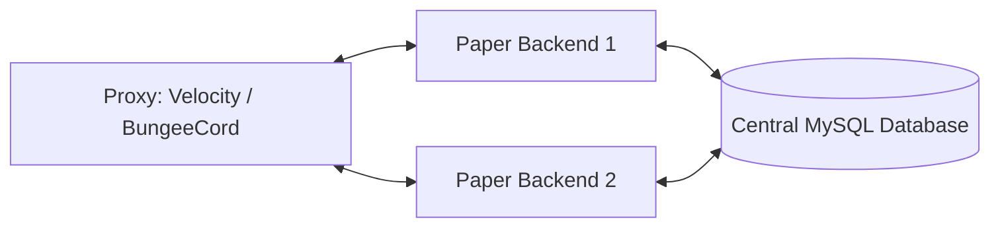

<div align="center">

# ReportSystem

**Next-Generation Visual Replay, Overwatch Review & Player Moderation System for Minecraft**

[](https://www.oracle.com/java/)
[](https://papermc.io/)
[](https://github.com/retrooper/packetevents)
[](https://github.com/KAREBLOK/ReportSystem/releases)
[](LICENSE)
[](https://discord.com/invite/WZc5bE9cK8)

[Türkçe Dökümantasyon için tıklayın (README_tr.md)](README_tr.md)

</div>

---

## Overview

**ReportSystem** is a modern, high-performance moderation and reporting ecosystem engineered from the ground up for modern Minecraft networks (Paper, Purpur, Velocity, BungeeCord).

Instead of relying on ambiguous text logs or easily falsified chat screenshots, ReportSystem captures **frame-accurate packet replays** of suspect behavior at the moment of reporting. Integrated with a **community-driven Overwatch system** inspired by CS:GO, automatic anti-cheat recording triggers, interactive GUI panels, and multi-channel notifications, it provides server administrators with complete visibility over server fair-play.

---

## Table of Contents

- [Key Features](#key-features)
- [System Requirements](#system-requirements)
- [Installation Guide](#installation-guide)
  - [Standalone Server (Paper)](#standalone-server-paper)
  - [Proxy Network (Velocity / BungeeCord)](#proxy-network-velocity--bungeecord)
- [Upgrading to 2.2.0](#upgrading-to-220)
- [Core Systems](#core-systems)
  - [1. Visual Replay Engine](#1-visual-replay-engine)
  - [2. Overwatch Community Review](#2-overwatch-community-review)
  - [3. Interactive NPC System](#3-interactive-npc-system)
  - [4. Punishment System & Animated Ban](#4-punishment-system--animated-ban)
  - [5. Smart Anti-Cheat Integration](#5-smart-anti-cheat-integration)
  - [6. Multi-Channel Notifications](#6-multi-channel-notifications)
  - [7. Discord Webhook Integration](#7-discord-webhook-integration)
- [Configuration Reference](#configuration-reference)
- [Commands & Aliases](#commands--aliases)
- [Permissions Reference](#permissions-reference)
- [PlaceholderAPI Placeholders](#placeholderapi-placeholders)
- [Performance & Optimization](#performance--optimization)
- [Troubleshooting & FAQ](#troubleshooting--faq)
- [Support & Community](#support--community)

---

## Key Features

- **Frame-Accurate Visual Replay:** Records over **53+ packet action types** (movement, combat, head rotations, sneaking, swimming, elytra flight, projectile trajectories, and block interactions).
- **Hotbar Replay Controls:** In-game controller items to Play, Pause, Fast-Forward (+10s), Rewind (-10s), adjust speed (0.25x to 2x), and teleport directly to suspects.
- **Overwatch Review System:** Empower trusted players to watch anonymized replays, analyze evidence, and cast votes with XP progression, ranks, and accuracy ratings.
- **Open Community Voting (v2.1.5+):** Flexible voting where any qualified player can review cases, while moderators hold final verdict authority or let the queue resolve automatically.
- **Animated Ban Spectacle:** Ban cheaters with lightning strikes, falling anvils, frozen movement, and custom global death alerts.
- **Anti-Cheat Hooks:** Native smart-scoring listeners for **Polar**, **Vulcan**, and **GrimAC**. Automatically records and queues suspects upon suspicious heuristic spikes.
- **Multi-Channel Alerts:** Staff notifications via interactive Toasts (Advancement popups), Screen Titles, Actionbar tickers, custom sounds, and clickable chat messages.
- **Proxy & Cross-Server Sync:** Full compatibility with BungeeCord and Velocity networks with centralized MySQL / HikariCP pooling.
- **PlaceholderAPI Integration:** Expose report counts, trust factors, Overwatch XP, ranks, and review stats on Scoreboards and TAB menus.
- **Discord Webhooks:** Embed notifications with color coding, player avatars, and interactive buttons for new reports, verdicts, and punishments.

---

## System Requirements

| Component | Minimum Requirement | Recommended |
| :--- | :--- | :--- |
| **Platform** | Paper 1.21+ (or a Paper fork such as Purpur) | Latest Paper |
| **Java** | Java 17+ (plugin bytecode target) | The Java version your Paper build requires (Paper 1.21 needs Java 21) |
| **PacketEvents** | **v2.13+ (MANDATORY)** | **v2.14.0+** (required for Minecraft 26.3) |
| **Database** | SQLite (Built-in for single server) | MySQL 8.0+ (HikariCP) |
| **Proxy (Optional)** | BungeeCord or Velocity 3.4+ (the Velocity jar requires Java 21) | Velocity 3.5+ |

> [!NOTE]
> **Folia is not supported.** The plugin does not declare `folia-supported` and uses the regular Bukkit scheduler.

> [!IMPORTANT]
> **PacketEvents is strictly required.** The Replay recording and playback engine depends directly on PacketEvents packet wrappers. The plugin will disable itself safely if PacketEvents is absent.

---

## Installation Guide

### Standalone Server (Paper)

1. Download `ReportSystem-Spigot-2.2.0.jar` and `packetevents-spigot.jar`.
2. Place both JAR files into your server's `plugins/` directory.
3. Start the server once to generate default configuration files and SQLite storage.
4. Customize `plugins/ReportSystem-Spigot/config.yml` and `messages_en.yml` (or `messages_tr.yml`).
5. Restart your server or run `/rs reload`.

### Proxy Network (Velocity / BungeeCord)



1. **Backend Servers (Paper):**
   - Install `ReportSystem-Spigot-2.2.0.jar` + `packetevents-spigot.jar` into each backend server's `plugins/` folder.
   - In `plugins/ReportSystem-Spigot/config.yml`:
     - Set `database.type: "mysql"`
     - Configure your centralized MySQL credentials (`host`, `port`, `database`, `username`, `password`).
     - Set `bungeecord.enabled: true` and `bungeecord.display-name` to the server's name **exactly as it is registered in the proxy** (e.g. `"survival-1"`).
     - Set `bungeecord.message-secret` to the same value on every backend and on the proxy (write it in quotes).
2. **Proxy Server:**
   - Place `ReportSystem-Bungee-2.2.0.jar` (BungeeCord) or `ReportSystem-Velocity-2.2.0.jar` (Velocity) into the proxy's `plugins/` folder.
   - Configure the same MySQL credentials and the same `message-secret` in the proxy config.
3. Restart the entire network.

---

## Upgrading to 2.2.0

2.2.0 changes the proxy-server message protocol and several default behaviours. Read this list before updating.

1. **Update the proxy and ALL backend servers to 2.2.0 together.** Mixed 2.1.x / 2.2.0 networks do not work. `message-secret` must be identical everywhere (proxy `message-secret`, Spigot `bungeecord.message-secret`) and server clocks must be NTP-synchronised (messages are accepted within a 30-second window). For cross-server replays, Spigot `bungeecord.display-name` must equal the server name in the proxy config.
2. **Write `message-secret` in quotes** (e.g. `message-secret: "abc123"`). Unquoted numeric-looking values are converted by YAML and will not match.
3. **Proxy ban check:** it now runs after login authentication (LoginEvent) and matches by UUID. The database is the source of truth; the in-memory list is only a fallback. Old bans that were stored by name only are bound to the player's UUID on their first join. Proxy `warn` now works.
4. **Hybrid premium/cracked networks** (FastLogin, or Floodgate without a username prefix): the same name can belong to different UUIDs. Name-only bans are bound to the UUID of the first account that joins with that name, so review such bans after upgrading and prefer issuing bans to online players.
5. **Spigot MySQL pool settings** (`database.mysql.pool.*`) are now actually applied (they were ignored before). The recommended `connection-timeout` is `5000`; if your existing file still has `30000`, lower it manually. New `database.mysql.ssl-mode` (default `DISABLED` = previous behaviour), also available in the proxy configs.
6. While watching a Replay or Overwatch case, only commands listed in `replay.viewer-allowed-commands` can be used (staff included). Viewers without `reportsystem.view.all` cannot move further than `replay.viewer-max-distance` (48 blocks) from the replayed player; movement is locked on the Overwatch "replay finished" screen.
7. Servers with a `language` other than `tr` (e.g. `en`) now read GUIs from `plugins/ReportSystem-Spigot/guis/en/`. If you customised `guis/*.yml`, move your changes there.
8. **Recording limits:** see `replay.limits.*`. A replay that exceeds the size limit is no longer discarded; it is trimmed from the end. Crash recovery uses the `recording-journal/` folder.
9. Replay data is read through a safety filter; recordings containing unrecognised data are not opened and are reported in the console.
10. **Dependencies:** sqlite-jdbc 3.54.1.0 (Paper downloads it on first start), mysql-connector-j 26.10.0, PacketEvents 2.14.0+ for Minecraft 26.3. Connector/J 26.x officially supports **MySQL 8.0 and newer**.
11. In the custom duration field, `perm` / `-1` / `forever` are now treated as an invalid duration; choose "permanent" for a permanent punishment.
12. New database columns `resolved_by` and `resolved_at` are added automatically. PlaceholderAPI values update with up to 30 seconds of delay. Proxy notifications go to players with `reportsystem.notify` (instead of the undefined `reportsystem.staff`).
13. The Spigot jar is no longer obfuscated (ProGuard was removed from the build).

---

## Core Systems

### 1. Visual Replay Engine

The replay engine is powered by virtual NPC packets and local chunk data caching. It accurately reproduces suspect behavior without modifying actual world blocks or interfering with living entities.

#### 53+ Recorded Action Types
- **Movement & Physics:** Precise X/Y/Z positions, yaw, pitch, head rotation, sneaking, sprinting, swimming, jumping, crawling, gliding (elytra).
- **Combat & Weapons:** Left-click swings, melee hits, critical hits, bow pull/charge/release, crossbow loading, shield blocking, totem of undying pops.
- **Inventory & Items:** Item switching, armor equipping, offhand swaps, item drops, pickups, eating food, drinking potions.
- **World Interaction:** Block break animations, block placement, chest/container opening, anvil usage, enchanting tables.
- **Vehicle & Riding:** Mounting horses/boats/minecarts, steering, dismounting.
- **Lifecycle & Status:** Damage animations, potion effects, burning, extinguishing, death, respawn, world switching, gamemode switching.

#### In-Game Hotbar Controls
When playing a replay, the reviewer's inventory is equipped with intuitive replay control items:

```
[ Slot 1 ]  Pause / Resume
[ Slot 2 ]  Rewind (-10 Seconds)
[ Slot 3 ]  Fast Forward (+10 Seconds)
[ Slot 4 ]  Exit Replay
[ Slot 5 ]  Speed Control (0.25x | 0.5x | 1.0x | 1.5x | 2.0x)
[ Slot 6 ]  Teleport to Suspect
[ Slot 8 ]  Replay Settings (Show hitboxes, trails, nearby players)
```

---

### 2. Overwatch Community Review

Inspired by Counter-Strike's Overwatch, ReportSystem empowers trusted community members to inspect anonymized replays and cast verdicts on reported players.

#### Progression & Ranks

| Rank | Required XP | Accuracy Requirement | Privileges |
| :--- | :--- | :--- | :--- |
| **BRONZE** | `0 - 499 XP` | - | Standard queue access |
| **SILVER** | `500 - 1,499 XP` | - | Priority queue assignments |
| **GOLD** | `1,500 - 3,499 XP` | 75%+ accuracy | Higher vote weight multiplier |
| **DIAMOND** | `3,500+ XP` | 85%+ accuracy | Expedited case processing & custom rewards |

- **Anonymization:** Suspect and reporter names can be hidden (e.g. `The Suspect #842`) to eliminate review bias.
- **Dynamic Scoring:** Players earn XP for correct verdicts. Submitting false verdicts or spamming degrades their reviewer score.
- **Open Community Voting (v2.1.5+):** Servers can enable open voting (`auto-complete-queue: false`), allowing the community to vote on cases while staff inspect statistics in `/reports` and issue the final ruling.

---

### 3. Interactive NPC System

Deploy interactive Overwatch NPCs in your hubs or lobbies using PacketEvents virtual entities:

- **Persistent:** Stored in database; safely restored across server reboots.
- **Customizable:** Change player skins, nametags, and floating text holograms.
- **Living Behavior:** NPCs dynamically look at nearby players as they walk past.

```bash
/overwatch npc create &b&lOVERWATCH &7(Click)
/overwatch npc skin <npc> Steve
/overwatch npc look <npc>
/overwatch npc move <npc>
/overwatch npc delete <id>
```

---

### 4. Punishment System & Animated Ban

Supports standalone bans/mutes as well as direct hooks into **LiteBans** and **AdvancedBan**.

#### The Animated Ban Experience
Punish blatant cheaters with a visual sequence:
1. The suspect is locked and frozen in place.
2. An anvil falls from high sky onto their head.
3. Thunder and lightning strike the exact location.
4. A custom broadcast is shown to all server players, followed by instant disconnection.

> [!NOTE]
> Animated ban requires the target player to be online. If offline, a standard punishment is executed immediately.

---

### 5. Smart Anti-Cheat Integration

ReportSystem integrates with anti-cheat solutions to automatically record and report cheaters:

```
[Anti-Cheat Flag] -> [Suspicion Score Accrues] -> [Threshold Exceeded] -> [Auto-Record 30s + Queue Overwatch + Discord Alert]
```

- **Supported Engines:**
  - **Polar Anti-Cheat:** Detects combat ML, movement, reach, mitigation events.
  - **Vulcan Anti-Cheat:** 35+ check types (KillAura, Scaffold, Speed, Flight). Requires `settings.enable-api: true`.
  - **GrimAC:** Deep packet prediction physics simulation.
- **Decay System:** Suspicion score decays by 50% every 60 seconds to eliminate false positives from lag spikes.

#### Suspicion Weight Matrix
| Check Category | Suspicion Score | Description |
| :--- | :--- | :--- |
| **Cloud Combat Behavior** | `+0.50` | Machine-learning combat anomaly (Polar ML) |
| **Auto Clicker** | `+0.45` | Inhuman CPS consistency & pattern detection |
| **KillAura** | `+0.40` | Multi-target angle snaps and combat packet abuse |
| **Scaffold** | `+0.35` | Inhuman bridging rotations and block placement |
| **Reach** | `+0.30` | Hits exceeding vanilla reach limits |
| **Flight** | `+0.15` | Vertical movement abnormalities |
| **Speed** | `+0.10` | Horizontal velocity violations |
| **Movement / Lag** | `+0.05` | Minor positional inconsistencies |

---

### 6. Multi-Channel Notifications

Staff members can receive alerts through multiple channels:

- **Toast Popup:** Advancement-style notification in the top-right corner.
- **Title Screen:** Headline and subtitle across the center of the display.
- **Action Bar:** Continuous non-intrusive notification above the hotbar.
- **Custom Audio:** Configurable sound alerts (pitch/volume).
- **Interactive Chat:** Clickable JSON messages with hover details (`[Teleport]`, `[Review]`).

---

### 7. Discord Webhook Integration

Synchronize in-game activity directly with your Discord staff channels:

- **Embed Messages:** Color-coded for New Reports (Gold), Replay Completed (Blue), Punishments (Red), and Verdicts (Green).
- **Interactive Buttons:** Direct review links and management shortcuts.
- **Multi-Language:** Adapts dynamically to your configured server language.

---

## Configuration Reference

### config.yml Snippet

An excerpt of `plugins/ReportSystem-Spigot/config.yml` (the generated file contains every key with comments):

```yaml
general:
  debug: false
  language: "en"               # en (English) or tr (Turkish)
  check-updates: true

database:
  type: sqlite                 # "sqlite" or "mysql" (use mysql for proxy networks)
  mysql:
    host: "localhost"
    port: 3306
    database: "reportsystem"
    username: "root"
    password: "CHANGE_THIS_PASSWORD"
    ssl-mode: "DISABLED"
    pool:
      maximum-pool-size: 10
      minimum-idle: 2
      connection-timeout: 5000
      idle-timeout: 600000
      max-lifetime: 1800000

bungeecord:
  enabled: false
  display-name: ""             # Must match the server name in the proxy config
  message-secret: ""           # Same value on the proxy and every backend, in quotes

reports:
  require-online: true
  cooldown: 60
  global-rate-limit: 5
  max-reports-per-player: 3

replay:
  enabled: true
  auto-record: true
  recording-duration: 45
  max-recordings: 3
  max-file-size: 5
  auto-delete-days: 7

overwatch:
  enabled: true
  auto-complete-queue: false   # false: open community voting (v2.1.5+)
  min-reviewers: 3             # Only used when auto-complete-queue is true
```

### Configuration keys added in 2.2.0

| Key | Default | Description |
| :--- | :--- | :--- |
| `database.mysql.ssl-mode` | `DISABLED` | Connector/J `sslMode`: `DISABLED`, `PREFERRED`, `REQUIRED`, `VERIFY_CA`, `VERIFY_IDENTITY`. Also in the proxy configs. |
| `database.mysql.pool.*` | see above | HikariCP pool (`maximum-pool-size`, `minimum-idle`, `connection-timeout`, `idle-timeout`, `max-lifetime`); now actually applied. |
| `replay.limits.max-actions` | `150000` | Maximum actions per recording (`0` or `-1` = unlimited). |
| `replay.limits.max-actions-per-type-per-second` | `400` | Maximum actions of one type per second (`0` or `-1` = unlimited). |
| `replay.crash-recovery.enabled` | `true` | Periodically checkpoints active recordings to `recording-journal/` and saves them on the next start after a crash. |
| `replay.crash-recovery.interval-seconds` | `10` | Checkpoint interval (minimum 2). |
| `replay.viewer-allowed-commands` | ReportSystem commands, private messages, `helpop` | Only these command labels work while watching a replay / Overwatch case. |
| `replay.viewer-max-distance` | `48` | Maximum distance (blocks) a viewer can move away from the replayed player; `0` = disabled. `reportsystem.view.all` is exempt. |
| `guis/en/` (folder) | - | English GUI files, used when `language` is not `tr`. |

---

## Commands & Aliases

### Player & Staff Commands
| Command | Aliases | Permission | Description |
| :--- | :--- | :--- | :--- |
| `/report <player> [reason]` | `/rapor`, `/reportplayer`, `/raporla` | `reportsystem.report` | Reports a player (opens the report GUI) |
| `/reports [page]` | `/raporlar`, `/reportlist`, `/raporlistesi` | `reportsystem.view.all` | Opens the staff report list (all reports) |
| `/overwatch` | `/ow`, `/overwatchsystem` | `reportsystem.overwatch` | Opens the Overwatch main menu |
| `/overwatch stats [player]` | `/ow stats` | `reportsystem.overwatch` | Shows Overwatch statistics (online player) |
| `/overwatch leaderboard` | `/ow lb`, `/ow top` | `reportsystem.overwatch` | Opens the reviewer leaderboard |
| `/overwatch help` | `/ow help` | `reportsystem.overwatch` | Shows Overwatch command help |

### Administrator Commands
`/reportsystem` aliases: `/rs`, `/rsystem`, `/raporsistem`.

| Command | Permission | Description |
| :--- | :--- | :--- |
| `/reportsystem reload` | `reportsystem.admin` | Reloads configuration and language files |
| `/reportsystem stats` | `reportsystem.admin` | Shows report statistics |
| `/reportsystem info` | `reportsystem.admin` | Shows plugin information |
| `/reportsystem lang` | `reportsystem.admin` | Shows the active language file |
| `/reportsystem debug <true/false>` | `reportsystem.admin` | Toggles debug logging |
| `/reportsystem testnotif` | `reportsystem.admin` | Sends a test toast notification to yourself |
| `/reportsystem checkadv` | `reportsystem.admin` | Checks the advancement (toast) status |
| `/reportsystem ban <player> <reason> [duration]` | `reportsystem.admin` | Bans a player |
| `/reportsystem unban <player>` | `reportsystem.admin` | Removes a ban |
| `/reportsystem unmute <player>` | `reportsystem.admin` | Removes a mute |
| `/reportsystem webreplay <reportId>` | `reportsystem.admin` | Generates a web replay link (when web replay is enabled) |
| `/overwatch addqueue <reportId> [priority]` | `reportsystem.overwatch.admin` | Adds a report to the Overwatch queue |
| `/overwatch npc <create/delete/list/skin/look/move/name/select>` | `reportsystem.overwatch.admin` | Manages Overwatch NPCs |

The proxy plugins (BungeeCord / Velocity) register no commands.

---

## Permissions Reference

These are the permissions declared in `plugin.yml`:

```
reportsystem.*                     # Default: op    - All ReportSystem permissions (children below, except bypass.anticheat)
reportsystem.report                # Default: true  - Create reports
reportsystem.report.others         # Default: op    - Create reports on behalf of others
reportsystem.view                  # Default: true  - View own reports
reportsystem.view.all              # Default: op    - View all reports (/reports); exempt from replay viewer distance limit
reportsystem.admin                 # Default: op    - /reportsystem admin commands
reportsystem.notify                # Default: op    - Receive report notifications (also used by the proxy plugins)
reportsystem.manage                # Default: op    - Accept / reject reports
reportsystem.punish                # Default: op    - Issue punishments (ban, mute, kick, warn)
reportsystem.delete                # Default: op    - Delete reports
reportsystem.cooldown.bypass       # Default: op    - Bypass the report cooldown
reportsystem.exempt                # Default: op    - Cannot be reported
reportsystem.overwatch             # Default: op    - Use the Overwatch system
reportsystem.overwatch.admin       # Default: op    - Overwatch admin commands (NPC and queue management)
reportsystem.bypass.anticheat      # Default: false - Given automatically to replay viewers so anti-cheats can use it as a bypass rule
```

---

## PlaceholderAPI Placeholders

| Placeholder | Output Example | Description |
| :--- | :--- | :--- |
| `%reportsystem_reports%` | `14` | Total reports received by the player |
| `%reportsystem_trust_level%` | `Good` | Player trust rating (Excellent, Good, Moderate, Poor, Critical) |
| `%reportsystem_trust_points%` | `0` | Violation penalty points (decays over time) |
| `%reportsystem_overwatch_rank%` | `GOLD` | Reviewer rank (BRONZE, SILVER, GOLD, DIAMOND) |
| `%reportsystem_overwatch_level%` | `12` | Reviewer progression level |
| `%reportsystem_overwatch_xp%` | `1850` | Current reviewer experience points |
| `%reportsystem_overwatch_reviews%` | `47` | Total cases evaluated by player |
| `%reportsystem_overwatch_accuracy%`| `91.4%` | Verdict accuracy percentage (unlocked at 50+ reviews) |

---

## Performance & Optimization

ReportSystem is architected for zero-tick-drop operation on production servers:

- **Asynchronous I/O:** Every database query (SQLite/MySQL) and disk write is dispatched on separate worker threads. `performance.async-database: true` guarantees zero main-thread blocking.
- **Smart Memory Cache:** Reports and active queue entries are kept in an LRU memory cache (`performance.cache.max-size: 100`, `expiry: 10m`), eliminating repeated SQL reads when paging through GUIs.
- **Optimized Replay Storage:** Average 45-second recordings occupy just **50–200 KB**. 100 daily reports generate under 20 MB of data.
- **Movement Delta Caching:** `movement-threshold: 0.05` filters micro-jitter from packet streams, shrinking replay file sizes by **40–60%** without noticeable loss of visual fidelity.

---

## Troubleshooting & FAQ

### Frequently Asked Questions

<details>
<summary><b>Does ReportSystem work without PacketEvents?</b></summary>
<br>
<b>No.</b> PacketEvents is a mandatory core dependency. Without it, the packet recording and playback engine cannot bind to the network pipeline.
</details>

<details>
<summary><b>Can two moderators watch the same replay at the same time?</b></summary>
<br>
<b>Yes.</b> All replay entities and particles are client-side virtual packets sent individually to the observer. Observers do not collide or interfere with one another.
</details>

<details>
<summary><b>Do replay arrows or potion splashes hurt real players?</b></summary>
<br>
<b>No.</b> All projectiles and particles spawned during replay sessions are synthetic packets. They cause zero real damage and cannot modify blocks.
</details>

<details>
<summary><b>Do Overwatch NPCs disappear after a server reboot?</b></summary>
<br>
<b>No.</b> All NPC locations, skins, and rotation parameters are stored in the database and automatically respawned when chunks load.
</details>

### Common Issues

- **Plugin fails to load:**
  - Verify Java version (`java -version` must be 17 or higher and meet your Paper build's requirement).
  - Verify PacketEvents is installed and matches your server version (2.14.0+ for Minecraft 26.3).
- **Replay won't record:**
  - Ensure `replay.auto-record: true` is set in `config.yml`.
  - Replays are stored in the database: check the console for database errors and that the server can write to `plugins/ReportSystem-Spigot/` (crash-recovery journal).
- **Database Connection Refused:**
  - Verify MySQL host, port, credentials, and check if your database server allows incoming connections through the firewall.

---

## Support & Community

- **Discord Server:** [discord.gg/WZc5bE9cK8](https://discord.com/invite/WZc5bE9cK8)
- **Issue Tracker:** Report bugs and feature requests on [GitHub Issues](https://github.com/KAREBLOK/ReportSystem/issues)
- **Website:** [kareblok.tc](https://kareblok.tc)

---

<div align="center">
ReportSystem is engineered and maintained by <b>KAREBLOK</b>.<br>
Licensed under the <a href="LICENSE">MIT License</a>.
</div>
